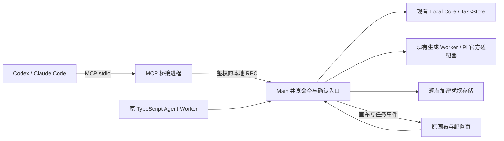

# 桌面本地 MCP 功能规格

> **2026-10-24 客户端接入扩展：** 授权入口与配置导出覆盖 Codex、Claude Code、Cursor、WorkBuddy、TRAE 和其他标准 stdio 客户端。名称仅用于展示；授权仍由受限本地凭据与项目/画布范围决定。是否允许生成由实际协商的 form elicitation 能力决定，不按品牌放行。依 MCP 2025-11-25 规范，严格空的 `elicitation: {}` 等价于 `elicitation: { form: {} }`；缺失 elicitation 或仅 URL 能力不能提交生成。专用配置导出、真实连接、自然语言操作、原生确认和实际供应商生成分别验收，见 [10-24 多客户端验收](../verification/2026-10-24-mcp-multi-client/README.md)。Windows 以外仍需实际机器，既有不重复安装/卸载的范围约定继续保留。

> **2026-10-17 最新交互契约：** 用户要求仅在生成时于外部 Agent 客户端确认。以下历史桌面短码配对、提供方披露批准卡和桌面外部生成确认描述不再是目标行为。已启用 MCP 且建立项目/画布/提供方范围后，连接使用受限本地凭证自动鉴权；凭据配置、只读测试及普通写入不弹人工确认。云端披露作为信息及范围记录保存。生成由桥接发起 MCP form elicitation；客户端不支持、拒绝、取消或超时均不生成。Main 签发会话绑定、单次使用、有时限的提案挑战，并在收到匹配结果后沿用原 ApprovalService/TaskStore 提交；桥接不得提供给模型可直接批准的工具。确认宿主属于用户信任的客户端，无法在服务端证明客户端 UI 的人工点击。内置 Agent 的确认不受影响。新协议与真实客户端验收另行记录，历史证据不得改写为新流程通过。

日期：2026-10-10；实现与验收接续：2026-10-15。状态：**受限媒体读取、真实 Agnes 图片/指定 Flash 视频、Windows 实际静默升级及已安装程序重开已验证；真实 Codex 本地生成完整回合经审查通过，原自动记录末尾 QA 误判保留；真实客户端官方媒体全链路仍缺，Claude Code 真实会话本轮由用户取消。**

依据：[AGENTS.md](../../AGENTS.md)、[Agent 功能规格](desktop-agent-functional-spec.md)、[提供方数据契约](desktop-provider-data-contract.md)。实施见[实施计划](../plans/2026-10-10-desktop-mcp-implementation-plan.md)。本文定义新增外部接口，不代表原 Web 模块或任何官方模型已通过 1:1/真实账号验收。

## 1. 已确认的产品范围

用户选择桌面应用运行时，外部 Agent 直接操作所选范围的画布；2026-10-17 更新为仅生成在外部 Agent 客户端确认。支持本机 Codex、Claude Code 等标准 MCP 客户端。外部 Agent 可协助填写图片、视频厂商的官方凭据、启用已实现模型并提交生成提案。其他已实现模态可复用相同任务通道，但本期图片/视频配置与生成是必须验收的纵向链路。

首期要求原画布创作页打开并且保存/同步服务就绪。窗口关闭、仅在导航页、应用退出或项目切换期间不得开始新的画布写入和生成提交；最小化不等于关闭。已提交任务沿用既有桌面生命周期，不因 MCP 断线或关闭客户端而自动取消；应用退出后的任务恢复沿用 TaskStore。首期不新增窗口关闭后持续创作的后台服务。

不提供公网访问、任意脚本执行、任意 SQL/文件操作、批量打开未知项目、平台账号/计费、外部 Agent 自动批准生成或自动申请/购买供应商 Key。外部调用不自动创建内置“小P”会话，不额外调用内置文本模型。

## 2. 运行架构与复用边界

| 组件 | 职责与约束 |
| --- | --- |
| MCP 桥接 | 初始化、能力发现、工具 schema/响应转换、客户端上下文；不持有项目写者锁，不打开第二份 Store |
| Main 共享入口 | 验证连接凭证、范围、项目/画布、取消、版本及客户端 form 单次挑战；协调保存/事件、配置和任务泵 |
| 原 TypeScript Agent 服务 | 复用工具 schema、CanvasCommandService、ApprovalService 与业务服务；提炼可由外部调用的执行上下文 |
| Local Core | 权威画布、素材、命令账本、TaskStore、SQLite 串行写入及恢复 |
| 提供方服务 | 复用 provider-settings、provider-network 与 Pi 目录/适配器；Key 仅在受控进程解密及使用 |
| 原前端 | 原 CanvasPage、节点结果、ProviderConfigurationPage 和既有确认视觉；不另造 Desktop 页面或任务抽屉 |

现有 `main.cjs` 的 Agent 请求处理器嵌在 Worker 生命周期内；生成/删除请求信任内部 TypeScript 已验证确认。现有接口是实现依据，**不能原样转发给 MCP**。共享入口必须能区分 `renderer / internal_agent / external_mcp` 来源，来源由可信通道建立，客户端不能伪造来源或 `runId`。

## 3. 连接、传输与授权

### 3.1 stdio 与安装交付

- 每个客户端启动轻量 stdio 桥接；多个桥接连接同一个桌面 Main。读取、编辑、配置以 Tools 为兼容基线；外部生成要求客户端协商支持 MCP form elicitation。Resources、Sampling 与协议任务扩展不作为前置。
- 用官方 MCP SDK 管理协议协商、schema 与响应；实现时锁定并验证 SDK 版本。stdout 仅写 MCP 消息，诊断走已脱敏 stderr。
- 桥接通过用户数据目录内受限的实例发现信息定位随机 loopback 端口；发现文件包含实例标识、端口和协议版本，不公开模型 Key 或长期连接令牌。Main 重启后更新实例信息，清理陈旧信息。
- 桌面记录客户端的项目、画布、媒体与提供方范围，配置片段只含可执行路径、连接标识和非秘密参数。桥接从固定用户数据路径 `mcp-bridge-auth.json` 读取当前 Main 实例的随机连接凭证，在受控 bootstrap 中自动鉴权；不显示短码或桌面连接批准。该文件与公开发现文件分开，不进入项目备份、配置片段、命令参数、日志或外部工具响应。读取拒绝符号链接、超限内容、过期实例及不安全的 POSIX 所有者/权限；Windows 使用原用户数据目录边界，不能宣称未做的 ACL 验证已通过。
- bootstrap 同时验证实例凭证、存活 grant、MCP 启用状态及当前项目/画布。随机会话令牌仅在内存交接，绑定 grant、当前实例及有效期；连接关闭/撤销/重启即失效，重连重新自动鉴权。公开 grantId、客户端名称与 roots 不能授予权限。请求鉴权先于业务读取与执行；连接数、请求数、大小和时限仍受限制。
- 自动连接与普通请求使用独立的限流计数：每个 loopback 地址 bootstrap 每分钟最多 8 次，普通 RPC/关闭请求每分钟最多 120 次，另保留会话限流和 32 个活动请求的并发上限。普通工具调用不能消耗 bootstrap 的额度，避免正常配置后重连被错误拒绝；任一类别实际超限仍返回 429，不因自动连接放宽鉴权或限流。
- 内部 loopback RPC 是私有通信，首期不承诺对外 HTTP MCP。HTTP 实现只绑定 `127.0.0.1`，校验 Host、存在时的 Origin、请求大小和时限，禁止代理转发与重定向，设置独立连接/请求上限。连接凭证不是模型 API Key。
- 安装包提供 stdio 启动器及兼容运行时，不依赖全局 Node、npx 下载或仓库当前工作目录；含空格路径及 Windows/macOS/Linux 分别验收。启动器不复用正常 GUI 标准输出作为 MCP 输出。
- 桌面未运行时明确返回 `DESKTOP_NOT_RUNNING`；首期不自动启动后台桌面或创建/打开项目。MCP 协议初始化可以成功后报告应用不可用，具体行为在 SDK smoke 中固定。
- 离线时只公布用于说明状态的 `get_context`。桌面恢复后，首次鉴权成功的普通调用会发送一次 `notifications/tools/list_changed`，提示客户端重新读取当前授权范围内的工具目录；桥接声明 `tools.listChanged`，不通过重放调用或扩大权限来刷新目录。客户端是否自动刷新仍依其实现，未响应通知时可重启该 MCP 服务。

### 3.2 权限与项目绑定

默认关闭。桌面设置中的“外部 Agent / MCP”区域负责启用、配对、授权、配置导出及撤销，属于本次明确授权的新功能。每个客户端连接有独立授权；`clientInfo.name` 仅作展示，不能作为鉴权依据。

| 授权 | 范围 |
| --- | --- |
| `canvas.read` | 授权项目/画布的摘要、节点、素材元数据 |
| `canvas.write` | 授权项目/画布内的低风险领域命令 |
| `generation.propose` | 准备生成提案、查询本人提案；实际提交另需客户端 form 确认 |
| `task.read` | 授权画布内任务状态与文本结果；图片/视频元数据另需 media.read 与对应 mediaTypes |
| `media.read` | 用户授权的具体媒体类别与受限预览/结果读取，独立披露 |
| `provider.read` | 提供方公开字段、模型能力、配置/检测状态；无秘密 |
| `provider.configure` | 用户指定提供方的设置、Key 写入/替换、模型启用及安全鉴权检测 |

提供方配置是应用级设置，可能影响其他项目；授权按提供方限定，不自动随画布写权限授予。首期不开放删除全部提供方配置或清空所有 Key 的工具。

授权 UI 保持可用的权限组合：`provider.configure` 同时选择并展示 `provider.read`，以获取保存所需的公开 schema、型号和 revision；`media.read` 同时选择并展示 `task.read`，以发现并调用任务结果读取工具。依赖项在对应能力启用时不可单独取消。厂商、字段、来源及媒体类别限制不变，Main 继续分别鉴权。退回仅提供方读取时，不校验或提交隐藏的凭据草稿。

项目切换使旧画布授权和待处理提案失效。应用级提供方授权可保留，但旧项目关联的未完成配置流程失效；客户端须获取新上下文。绑定新项目必须由桌面授权。MCP roots、客户端传入 ID、目录或 `confirmed/consent` 字段不能授予权限。

授权页披露 MCP 返回的文本、提示词、图片/视频预览等可能被外部 Agent 发往其模型服务；读取元数据不自动授权读取媒体字节。默认不读取内置会话、记忆、全局目录或凭据。撤销授权/关闭 MCP 后拒绝新请求并停止尚未提交的写操作；已提交任务仍通过 TaskStore 管理。

## 4. MCP 工具契约

下列名称是目标接口。已有领域工具从原 TypeScript 实现复用；新增上下文、配置、提案查询工具须放在同一 TypeScript 服务边界。不得仅因目录存在就宣称接口可用。

| 工具 | 输入要点 | 响应/副作用 |
| --- | --- | --- |
| `get_context` | 无路径参数 | 桌面可用状态、授权范围、项目/画布身份、版本、能力列表；无授权时不泄漏项目详情 |
| `get_canvas_summary` / `get_node_detail` | 节点身份（详情） | 权威内容；摘要裁剪、详情按需获取 |
| `search_assets` | 查询与分页 | 当前项目素材元数据；不直接返回任意本机文件 |
| `list_models` | 可选模态过滤 | 稳定 bindingId、真实能力、参数约束、启用状态和不可用原因；不含凭据 |
| `create_nodes` / `update_node_config` | 原 schema，明确参考关系；写入 operationId/版本 | 真实节点及完成步骤；遵循原领域规则 |
| `connect_nodes` / `layout_nodes` | 明确端点/原布局参数；operationId/版本 | 真实边/布局；不推断多参考到多目标的笛卡尔积 |
| `prepare_generation` | 目标、bindingId、参数、明确参考；operationId/expectedVersion | 持久化提案；桥接在同次调用中请求客户端 form 确认，批准后沿原任务通道提交，返回状态/任务；拒绝、取消或不支持均不提交 |

`prepare_generation.generations[].modelType` 是兼容原生成 DTO 的字段名，其值须从 `list_models` 返回的精确 `name` 或 `bindingId` 复制。它不是目录的模态字段 `modelType`，也不是供应商调用 ID `apiModelId`；服务端只做精确查找并规范为目录 `name`，不按展示名称、简称或相似文字推断模型。
| `get_operation` | operationId 或 proposalId | 本连接可查询的权威执行/确认状态、任务关联与错误 |
| `check_task_status` | taskId | 状态、错误、结果元数据；成功以文件已落盘且可读取为准 |
| `read_task_output` | taskId、outputIndex（0–3，默认 0）、mode（metadata/preview）、文本 offset/limit | 文本分页；图片/视频默认元数据，显式 preview 返回受限媒体内容；不给任意目录读取能力 |
| `list_provider_configuration` | providerId（必填，限定已授权厂商） | 凭据字段定义、configured、公开配置、revision、检测状态与官方披露版本；有配置授权时另返回该厂商允许的字段、输入方式及不含值的来源引用 |
| `configure_provider` | providerId、expectedRevision、operationId、公开配置、凭据来源 | 保存/授权状态及公开快照；只写凭据，不回显 |
| `test_provider_connection` | providerId、已保存 revision | 已核验官方安全鉴权结果或 unsupported；不隐式调用收费生成 |

`prepare_generation` 是原单个/批量生成准备能力的 MCP 映射；复用 GenerationTools/ApprovalService，不能另写省去确认的生成工具。普通写入可直接执行；删除、清空、不可逆覆盖及超过20个节点的批量创建，只在共享撤销/预览确认能力接通后开放，缺失时从工具列表省略并报告缺口。

工具 schema 拒绝未知字段；输出提供 `structuredContent` 及兼容客户端的精简 text。业务错误使用 `isError` 与稳定错误码，协议错误遵循 SDK。只读、破坏性、幂等和联网注解据真实行为声明，注解不代替服务端授权。MCP 输出可包含供程序关联的内部 ID；用户自然语言回复继续使用原可见名称，不暴露内部工具或标识。

文本结果按 Unicode 字符分页，offset 范围 0–1,000,000，limit 范围 1–5,000（默认 5,000），返回 nextOffset/totalCharacters/hasMore。多输出索引范围 0–3。图片/视频的元数据和预览均须具备 `task.read`、`media.read` 及对应 mediaTypes；默认 metadata 不返回字节或本机路径。显式 preview 读取已落盘的原文件：PNG/JPEG/WebP 图片最多 4 MiB，返回 MCP image；MP4/QuickTime/WebM 视频最多 8 MiB，返回嵌入 resource blob 和不含路径的任务 URI。超限明确拒绝，不截断文件或隐式全量发送。Local Core 校验项目/画布/任务状态、路径与符号链接、文件句柄、类型、大小及 SHA256；Main 在读取后再次检查授权和取消状态。大视频及任意导出路径不在首期。原节点媒体展示继续使用既有任务通道。取消协议请求不等于取消已提交生成任务；首期不额外承诺供应商远端取消。

## 5. 外部 Agent 配置图片/视频 API Key

### 5.1 用户流程

1. 用户在桌面授权某个连接的 `provider.configure`，限定厂商与可写凭据字段；读取公开目录不获得写权限。
2. 用户在 Codex/Claude Code 提出“帮我配置图片/视频模型”，Agent 查询官方 credentialFields、已实现绑定及参数约束。
3. Agent 选择用户要求的模型和参数，提交 `configure_provider`。可填写新 Key、替换 Key，或不提供秘密以保留原凭据；不支持回读已有秘密。
4. 在已配置的厂商/字段范围内直接保存配置，并记录供应商、发送内容与费用说明；不弹待批准披露卡。原字段默认密码黑点，眼睛按钮只显示本次输入。
5. 返回 `saved` 后可调用安全鉴权检测；只有真实请求成功返回 `connected`。`unsupported`、网络失败、鉴权失败、未检测均独立展示。`saved` 不等于 Key 有效或账户拥有模型权限。
6. Agent 创建/配置目标节点并准备生成；客户端 form 显示目标、模型、输入及覆盖影响，用户批准后提交任务。Agent 查询状态，结果回显原节点。

提供方信息须复用原配置页的供应商、发送类型、参考上传与可能费用说明。保存和普通安全探测不弹确认；提供方/字段超出已配置的客户端范围则拒绝，不能由工具参数自行扩大。生成确认是独立的客户端事件。

### 5.2 凭据输入方式

| 方式 | 行为与边界 |
| --- | --- |
| `authorized_env`（优先） | 用户在连接设置授权 providerId/field 到特定环境变量的映射。Agent 仅提交 sourceRef；桥接读取其启动环境中该精确变量并提交 Main。变量值不放入配置片段、命令参数或响应，变量名/映射不是秘密。Codex 导出配置仅将已授权的环境变量名列入 `env_vars`，按名称去重；没有授权映射时不输出该项。进程启动后新增变量须重启桥接；缺失明确报错 |
| `desktop_input` | Agent 准备公开配置，原配置页接受用户输入；完成后返回配置状态。兼容没有安全输入能力的 MCP 客户端，不强依赖 URL elicitation |
| `inline` | 用户明确把 Key 交给外部 Agent 并授权提交时，工具接受一次性 `credentials` 字段。传输层在任何请求记录前识别秘密，不向 VibePaper 日志/JSONL/账本写原文；响应不回显。外部聊天、模型上下文、客户端工具日志可能已保存原文，VibePaper 无法保证其删除或脱敏 |

三种方式必须满足 provider.configure 与字段授权；`inline` 是否可用由桌面连接授权明确开启，schema/能力如实反映，不能仅靠工具参数 `authorized=true` 开启。不能要求用户为了帮助配置必须把 Key 粘贴到聊天；也不能把用户明确授权的外部代填一律改成只能手工输入。

sourceRef 由可信连接设置注册，绑定连接、providerId、字段和有效期；不是任意环境变量名/文件路径。多字段鉴权用 `sourceRefs: {credentialFieldName: sourceRef}` 逐字段映射，不能以一个引用获得其他字段。`credentialInput` 三种模式互斥；inline 使用 `credentials: {credentialFieldName: value}`，缺省整个 credentialInput 表示保留已有凭据。不提供枚举环境、读取 `.env`、访问浏览器密码或从其他客户端配置复制 Key 的能力。桥接不继承无关模型秘密到其他子进程。

Agent 从 `list_provider_configuration` 获取 `credentialSources`、`allowedCredentialFields` 和 `credentialInputModes`。来源目录只含 sourceRef、厂商、字段、来源类型、环境变量名及过期时间，绝不含变量值；限定当前连接、厂商及有效配置授权。仅有读取权限时，这三个数组为空。引用过期或授权变更后重新读取目录，不能猜测引用或使用其他连接的引用。

共享工具 schema 须列出已支持的公开配置字段 `providerId`（可选且须与外层一致）、`baseUrl`、`enabledModelIds`、`defaultModelIds`、`modelDefaults`、`timeoutSeconds`（10–600），模型绑定及参数能力从该提供方目录读取。工具说明须明确字段名到授权 sourceRef 的映射规则，不能要求外部 Agent 猜测配置格式。

新流程不返回要求用户批准的 `awaiting_disclosure`；供应商披露范围由 Main 在配置调用中记录。只有 `saved` 表示保存成功。同一配置重放复用操作标识和参数；重新连接的凭据引用从新连接目录取得，任何结果不确定的写入先查询权威状态，不盲重放。历史版本的 `awaiting_disclosure` 证据保留原含义。

不用 MCP **form** elicitation 收集 API Key。若后续采用 URL elicitation，须协商客户端能力且只返回无秘密的一次性受控输入地址；首期仍可回到原配置页完成，不把客户端是否支持 elicitation 作为配置前提。

### 5.3 保存、校验与恢复

- 复用 provider-settings 的字段定义、厂商路由、credentialFields、官方主机白名单、模型约束和 safeStorage；不是每家厂商都只有一个 apiKey，AK/SK 等组合遵循原校验。同品牌不同服务凭据不混用。
- 缺省/空白秘密保留已有值；没有已保存值且缺少必填字段时拒绝。对有互斥鉴权方式的厂商沿用原合并规则；不把空值解释为删除全部 Key。
- 基于配置 revision 做 CAS。Key 或端点更改使检测状态失效；已提交任务参数保持原快照，凭据替换的后续解析沿用既有任务政策，不能另行把 Key 快照塞入 TaskStore。
- 公开配置、加密凭据文件与操作账本不是同一事务。实现必须有持久化的准备/提交/恢复状态及可检测配置 revision；跨文件失败不能报告 `saved`。不完整 revision 暂不可用于新生成；安全修复/回退后才启用。加密暂存/旧版本只放安全凭据存储，普通账本仅存不透明引用。
- 不保存任何明文秘密或普通 Key 哈希供重放。秘密相关请求相等性使用受控进程内、密钥受保护的 HMAC/版本关联；不公开指纹。丢失响应时通过 operationId 查询已保存 revision，不向客户端重新返回 Key。
- 内存秘密尽早释放；JavaScript 无法保证字符串物理擦除，不作绝对承诺。原始请求/异常/上游响应禁止通用日志记录；公开错误使用固定码及已脱敏说明。
- 系统加密不可用或 Linux basic_text 时返回 `SECURE_STORAGE_UNAVAILABLE`，不落明文、不启用云端生成。现有原配置页与原 Agent 路径保持兼容。

## 6. 生成提案、执行与同步

提案状态：`awaiting_confirmation → submitting → submitted`，另有 `rejected / expired / invalidated / failed`。提交结果不确定时返回 `submission_unknown`，查询现有账本/关联继续协调，不盲重发。`submitted` 仅表示本地任务已耐久创建；任务独立使用 `queued → running → succeeded | failed | cancelled`。

确认记录绑定连接、项目、画布版本、目标、模型绑定及提供方配置 revision、完整参数及参考内容版本/哈希、操作摘要和有效期；复用原 ApprovalService 验证/消费语义。Main 为桥接签发单次挑战，桥接使用客户端 form elicitation 收集本次生成决定，再经私有 `generation/confirm` RPC 送回。挑战不进入模型工具参数、响应、会话或持久化账本，不提供模型可调用的批准工具。Main 消费挑战并复核会话/授权/版本/有效期/取消状态后才提交；结果不确定时不重放。客户端是用户信任的确认宿主，服务端不能证明宿主内部确由人点击。已提交任务按权威状态恢复。

同一提案已有未过期、未消费的挑战时，并发或重放准备请求返回 `GENERATION_CONFIRMATION_PENDING`，不覆盖原挑战、不再触发第二份表单。原表单仍可正常确认。连接清理沿用原机制使其挑战失效，不能跨会话消费；已完成的提案继续查询原任务状态。

外部确认在 Codex 等客户端显示目标、模型、输入、覆盖影响和云端可能费用；只接受明确确认，不采集秘密。桌面不再显示第二张外部生成确认卡。内置 Agent 的原确认卡保持不变。不支持 form 的客户端明确返回能力错误，不能降级成自动批准。

客户端确认有时限。提交前在提供方解析等异步步骤之后再次校验会话/范围/取消，并紧接着同步派发原 Local Core 的 `task:create`；这是提交边界。此前断线、取消或超时不提交新任务。进入提交后断线可能丢失结果，须查询账本，不能承诺跨进程插入时刻的回滚，也不能重发上游。长视频任务返回提案/operationId 后查询，不让工具无限等待生成。

提案内容由原 Worker 的不可变 ApprovalService action/binding、签名 actionHash 和操作 digest 验证；Main 的挑战关联同一个 proposalId 和 canvasVersion，不把提示词再复制到设备账本。该绑定与一次性会话挑战分别测试，不能把客户端传入的确认摘要当作权威参数。

外部写入前通过 Main 向原 Renderer 请求保存屏障，带项目、画布和唯一请求标识；flush 等待当前序列及持久化响应完成，期间排队后续编辑，避免新编辑混入旧保存。保存失败、窗口关闭或身份变化均拒绝外部写入，不强制覆盖。屏障完成后检查 expectedVersion；过期返回冲突，重新读取后提交新操作。不能以客户端 snapshot 声称权威版本。

所有 Renderer/内置 Agent/MCP 写入通过同一权威写入序列；Local Core 保持 CAS。成功后发布 `canvas.changed`，携带项目、画布、版本、来源及 operationId；Renderer 跳过旧版本事件，保存完成后应用权威变更、保留后续未保存编辑，释放屏障。整图保存只能用经过版本校验的原保存路径，不能自动提交旧快照来解决冲突。

任务事件复用原节点任务 feed；外部操作的画布事件不依赖当前内置 Agent session 订阅。不新增正常创作任务抽屉，也不伪造小P消息。

## 7. 数据字典与幂等

下表定义行为契约，实际存储按本节末的落盘映射。安全策略和客户端注册是设备级 userData 数据，不混入项目备份；项目操作与生成提案关联进入原控制存储。

应用级提供方操作与披露账本放设备级 `userData/mcp-control.sqlite`，不写入项目控制库/备份。该库的受控写者由 Main 生命周期管理，桥接不能直接打开。项目备份/恢复不携带连接凭证或设备授权，恢复项目的待确认外部提案失效，不能因复制同名 clientId 恢复执行权。

| 记录 | 字段与约束 |
| --- | --- |
| ClientGrant | grantId、clientId、permissions、providerIds/credentialFieldNames、credentialInputModes、projectId/canvasId、mediaTypes、disclosureVersion、issuedAt/expiresAt/revokedAt；grantId是范围记录身份，不是鉴权秘密 |
| McpConnection | connectionId、clientId、instanceId、grantId、protocolVersion、connectedAt/expiresAt；会话令牌只在内存，不进持久记录；连接名仅作显示，不作权限 |
| BridgeInstanceAuthentication | 固定 `userData/mcp-bridge-auth.json`，schemaVersion=1、instanceId、随机 secret；Main 原子创建并按实例轮换，桥接只读固定路径；独立于公开发现文件，不导出或加入备份 |
| GenerationConfirmationChallenge | proposalId、challengeToken 的受控内存校验值、connectionId/clientId/grantId/projectId/canvasId、canvasVersion、expiresAt；单次消费，断线/取消/重启失效；只在 Main 与桥接私有通道交接，不提供给模型 |
| CredentialSource | sourceRef、clientId、providerId、fieldName、sourceKind、envVariableName（仅 env）、expiresAt；秘密值不进入此记录 |
| McpOperation | operationId、clientId、grantId、source=external_mcp、projectId/canvasId（配置可无）、kind、payloadDigest、status、result/errorCode、createdAt/updatedAt；不持久化原始凭据请求 |
| GenerationProposal | proposalId、operationId、clientId、projectId/canvasId、canvasVersion、modelBindingId、providerRevision、normalizedInputs、referenceDigests、approvalId、expiresAt、status、taskIds；不含 Key 或可供客户端批准的 token |
| ProviderConfigurationRevision | providerId、revision、publicConfigDigest、credentialRevision、disclosureVersion、consentRecordId、commitState；秘密版本/暂存内容仅在安全存储 |
| ProviderProbeResult | providerId、revision、status、checkedAt、sanitizedErrorCode/message；配置 revision 变更失效，不存响应原文/账户历史 |
| CanvasChanged | projectId、canvasId、version、source、operationId、changedNodeIds；公开事件无凭据/提示词正文 |

operationId 是客户端可持有的重试标识，作用域含可信 clientId 和授权对象；MCP JSON-RPC request id 不作为稳定幂等键。同键同内容返回已持久化结果，同键异内容返回 `IDEMPOTENCY_CONFLICT`。批量领域操作如非原子，必须返回完成步骤、失败步骤及已经发生的副作用，不能伪报整体成功。任务/操作查询须再校验当前授权。

当前存储映射：设备 MCP SQLite `user_version=1`，表为 `mcp_settings`、`mcp_clients`、`mcp_actions`、`mcp_operations`；项目原 Agent 控制库升级至 schema 11，增加 `desktop_mcp_operations`、`desktop_mcp_proposals`，后者用 `provider_revisions_json` 保存整批提供方及本地连接 revision。规范化生成参数与参考内容继续由原 ApprovalService 的 action/binding 保存，提案通过 `approval_action_id` 关联，不另存一套可由客户端批准的 token。操作公开结果可含完成 effect 的节点/边/任务身份，以及 `partial` / `submission_unknown`，无原始凭据请求。

提供方普通配置使用 `providers.json` schemaVersion 2，凭据版本、暂存和回滚内容仅位于 `credentials` 下的系统加密文件；普通事务记录只保存公开状态和不透明引用。策略、配置及项目控制库均需按各自版本执行原子写入/迁移备份。客户端升级/重连不盲重放写入；旧授权过期/被撤销时即便查到旧 operation 也不得继续提交。用户数据目录位置使用操作系统标准能力，不硬编码开发机盘符。

## 8. 错误与验收契约

稳定错误码包括运行不可用、授权/版本/幂等/确认失效、凭据来源和安全存储错误；新增客户端未协商 form 的 `CLIENT_CONFIRMATION_UNSUPPORTED`。具体公开码以实现映射与测试为准；错误响应不回显 Key、挑战、连接秘密、任意本机路径或供应商原文。

| 场景 | 必须观测到的结果 |
| --- | --- |
| Codex / Claude Code，各自连接 | stdio 初始化、授权、工具发现和一次完整工具调用；分别记录客户端版本 |
| 未运行/导航页/窗口关闭/切换项目 | 明确不可用；无新画布写入/任务；旧范围不能自动访问新项目 |
| 图片/视频配置 | 两类模型均有 env 来源和 inline/原配置页路径覆盖；保存后原模型选择器一致刷新 |
| 密钥与权限 | 无配置权限不能写；sourceRef 不能读其他变量；响应、普通账本、日志、JSONL、导出、配置片段无秘密 |
| 配置部分失败/重试/并发 | 不虚报保存；不完整 revision 不生成；同键查回结果，异内容冲突；原配置页编辑受相同版本控制 |
| 鉴权检测 | 有效/无效/超时/unsupported 真实区分，不自动收费；无真实 Key 时仅记录 fixture |
| 生成确认 | 单个/批量客户端 form 确认；不支持、拒绝、取消、过期、重启、模型/参考/版本变化不提交；`confirmed:true` 不能批准 |
| 三参考三目标 | 仅三条正确的一对一参考关系，原画布即时可见 |
| 并发编辑 | 用户未保存提示词/拖拽不丢失；冲突可见；成功外部修改不被旧快照覆盖 |
| 断线/响应丢失/进程中断 | 不重复节点/任务/上游提交；先查权威账本；客户端退出不伪称取消供应商任务 |
| 真图片/真视频生成 | 用户授权真实账号，客户端确认后创建任务，文件可读、原节点可见；fixture 不替代此证据 |
| 安装包 | 三平台可启动桥接；无全局 Node；含空格路径；安全存储失败明确，无明文回退 |

真实 Key 验收由用户在授权输入链路提供，不在文档/测试 fixture 保存；截图/录屏隐藏秘密。外部客户端自己的 inline 会话保存风险单独披露，不冒称由 VibePaper 的日志脱敏解决。

## 9. 实施状态与协议依据

已有可复用基础：原 runtime-tools、DesktopLocalToolGateway、Main 的私有 Agent dispatch、Local Core/TaskStore、provider-settings/safeStorage、原配置页、原画布持久化与 Agent 刷新。

2026-10-11 已接通 stdio/Main/原 TypeScript Worker/原 Renderer，2026-10-12 补媒体读取与真实账号验证。提供方模块包含 schemaVersion 2 配置 revision、加密凭据暂存/恢复与清除 tombstone；MCP controller 按 live grant、字段、来源、披露及操作账本校验。官方 SDK 锁定 `@modelcontextprotocol/sdk@1.32.1`。独立桌面回归增至 128/128，Pi 完整检查通过。SDK/原画布验证节点、一对一连线、桌面确认、本地任务与结果展示；真实 Agnes 图片经受限授权输入、Windows safeStorage、原桌面确认生成成功，并验证 MCP 字节摘要。Flash 视频前两次在创建端遭 HTTP 503 队列拒绝，10-13 同模型/参数第三次生成成功；安全鉴权检测明确 unsupported。Windows NSIS 已构建，含空格最终载荷与用户授权后的实际静默升级均完成原生配对、包内 stdio/画布写入；实际安装关键文件摘要和注册项已核对，正常关闭重开保留数据。手工安装向导页面及卸载未验收。实际客户端、账号与安装边界见[最新验收记录](../verification/2026-10-11-mcp-acceptance/README.md)，初始 fixture 见[审查记录](../verification/2026-10-10-desktop-mcp/README.md)。

用户操作说明见[桌面 MCP 指南](../guides/desktop-mcp.md)。本节记录代码入口与存储结构；完整行为验收仍以独立证据为准。

当前代码入口（实现不等于已验收）：

| 边界 | 代码入口 |
| --- | --- |
| SDK stdio 与启动环境 | `pi-paper-desktop/src/mcp-node-entry.cjs`、`mcp-stdio.cjs`、`mcp-launcher.cjs`；导出配置使用 `ELECTRON_RUN_AS_NODE=1` 启动内置 Node，安装包显式保留 runAsNode fuse，普通 GUI 入口不作为 stdio 交付路径 |
| 连接、设备授权与受限 Main RPC | `pi-paper-desktop/src/mcp-main-service.cjs`、`mcp-control-store.cjs`，由 `main.cjs` 创建与关闭 |
| 共享 TypeScript schema、原工具与项目账本 | `pi-main/packages/vibepaper-agent-service/src/desktop/mcp-runtime.ts`、`control-store.ts`、`local-tool-gateway.ts`，由原 `agent-worker.cjs` 承载 |
| 提供方写入与恢复 | `pi-paper-desktop/src/mcp-provider-controller.cjs`、`provider-settings.cjs`，继续使用原官方目录、字段与系统加密能力 |
| 原 UI 同步与确认 | 原 `CanvasPage`、`AgentPanel`、`ProviderConfigurationPage`、受限 Preload；新增 `/settings/mcp` 只负责本次授权的连接管理 |

文本分页、多输出索引和受限图片/视频读取已实现；协议、路径安全和授权专项测试通过。真实 PNG/Flash MP4 经 Main/Local Core/SDK 返回的字节与 TaskStore、本地文件及验收副本摘要一致；原视频节点播放和 FFmpeg 全片解码已验证。真实客户端、账号生成及安装包的最新逐项状态见 [2026-10-11 验收记录](../verification/2026-10-11-mcp-acceptance/README.md)。用户本轮要求先测 Windows，macOS/Linux 没有测试机器，保持未验收；Claude Code 真实会话由用户取消本轮验收。

2026-10-10 核对的官方资料（客户端实际支持按实施时版本再次验证）：

- [MCP 传输规范](https://modelcontextprotocol.io/specification/2025-11-25/basic/transports)：stdio 输出边界与本地 HTTP 防护。
- [MCP Elicitation 规范](https://modelcontextprotocol.io/specification/2025-11-25/client/elicitation)：form 不收集敏感凭据，URL 模式需能力协商。
- [Codex MCP 文档](https://developers.openai.com/codex/mcp/)：stdio/Streamable HTTP 与连接配置。
- [Claude Code MCP 文档](https://code.claude.com/docs/en/mcp)：本地 stdio、HTTP 与配置范围。

2026-10-17 已读取 [Codex App Server 的 MCP elicitation 说明](https://learn.chatgpt.com/docs/app-server#mcp-server-elicitation-requests)：客户端收到表单请求后返回 accept/content 或 decline/cancel。另读取 [Codex 配置参考](https://learn.chatgpt.com/docs/config-file/config-reference)核对服务级工具许可配置；应用只生成自身连接片段，不修改用户或组织的整体许可策略。协议支持不等于已完成当前桌面客户端弹窗验收。
