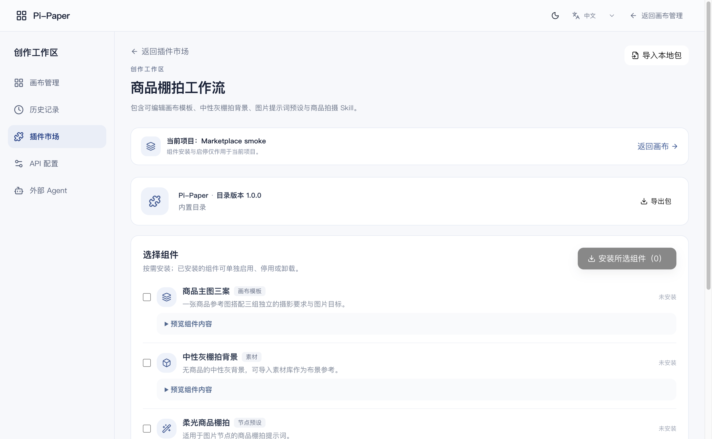

# 桌面插件市场首期验证

2026-11-02，在 macOS ARM64 上使用隔离项目和用户配置进行验证。首期目录随应用交付，也支持本地 JSON 包。Windows、Linux 正式安装包、远程市场及付费生成待另行验收。

| 验证入口 | 观察到的结果 |
| --- | --- |
| TypeScript、完整前端 Vitest、Vite | 编译和生产构建成功。Node 24 开启 Web Storage 并使用临时文件后，32 个测试文件、158 项用例通过。 |
| 市场服务、原项目 Skill、路由测试 | 12 项通过。覆盖选装、停用、升级冲突、回退、保留用户启停及卸载选择、导入校验、项目隔离、真实素材入库与备份恢复。 |
| 画布集成 | 同一模板插入两次后为 14 个节点、12 条边，两次插入之间没有交叉引用。幂等重放不会重复增加节点，过期版本无法覆盖画布。 |
| macOS Electron 桌面流程 | 从工作区打开插件市场，安装四类棚拍组件。从原 Agent 服务读到已启用的商品棚拍 Skill。通过画布工具插入 7 个节点、6 条有效连线，将背景素材添加到画布，向选中图片节点应用提示词预设。重载后共 8 个节点可读，生成任务数为 0。 |
| 打包载荷 | build-package 成功生成独立应用目录，Agent Worker 重启测试通过。使用随项目的 Electron 加载该目录复验上述市场流程。这一步验证安装载荷，不代表安装向导、签名或升级流程通过。 |



复现时在仓库根目录运行：

```sh
node pi-paper-desktop/scripts/build-package.cjs
node --test pi-paper-desktop/test/marketplace.test.cjs pi-paper-desktop/test/project-agent-skills.test.cjs pi-paper-desktop/test/renderer-trust.test.cjs
node pi-paper-desktop/node_modules/electron/cli.js pi-paper-desktop/scripts/smoke-marketplace.cjs --staged
```

存量测试限制：另跑 project-navigation.test.cjs 时，三项用例在旧 Electron mock 的 app.commandLine.getSwitchValue 处中止。此次市场交付对真实 Electron 使用上述独立项目完成了导航验证。

## 后续能力验证与会话续接

续接本次工作时，先查看 GitHub 默认分支 `feat/desktop-local-migration` 与本次会话 worktree 分支 `codex/plugin-marketplace-mcp` 的提交号，再阅读本页、[设计方案](../../plans/2026-11-02-desktop-plugin-marketplace.md)和[在线目录验证](online-catalog.md)。

- 工作区「插件市场」含棚拍、创作工作室、MCP 连接器三个内置包。本地 JSON、独立 Pi Skill 与在线资源先进入目录，按项目选择组件。在线目录已发布在默认分支。个人与项目预设分层保存，安装、使用和创建生成任务分别验证。
- macOS ARM64 的隔离 Electron GUI 中完成独立 Skill 导入、真实 GitHub 下载、MCP 范围预填、图像素材和预设应用、可编辑海报的本地 PNG 输出以及分镜 CSV 文件读回。打开导演台应用场景、机位与运镜、播放后关闭，从存储重新读到两个对象和 4 秒运镜。全程未创建生成任务。没有使用供应商凭据。
- MCP 设置预填后原服务保持关闭，客户端授权计数为零。另用本机真实 stdio 测试程序验证工具发现、指派、仅发送文本、超时终止及停用拦截。用户选的程序以系统用户身份运行。历史上用户取消的 Claude Code 真实会话测试仍按原记录。
- 修复了桌面保存状态标记吞掉第一次导演编辑的问题。首期记录中未通过的三项导航 mock 用例现已通过。测试区分可编辑相机过渡预览与渲染动画视频。
- 本机另外验证了隔离的未签名 ARM64 应用包内可执行文件的 Agent/SQLite/MCP fixture；这与使用 Electron 打开指定安装资源的 GUI smoke 分别计证据。

**复现。** 依赖就绪后运行 `node pi-paper-desktop/scripts/build-package.cjs`。在线端到端验收运行 `node pi-paper-desktop/node_modules/electron/cli.js pi-paper-desktop/scripts/smoke-marketplace.cjs --staged --online`；省略 `--online` 可检验离线路径。后端使用 Node 24 在真实临时目录运行 `node --test pi-paper-desktop/test/marketplace*.test.cjs`。macOS 下测试若使用符号链接形式的系统临时路径，可设 `TMPDIR=/private/tmp`。前端完整套件在 Node 24 的实验性 Web Storage 和独立临时存储下运行。

**下一步检查。** 在默认分支最终提交的 GitHub Actions 中核对 Windows NSIS、Linux AppImage、macOS ARM64/x64 DMG 的实际运行结果。源码测试、安装载荷 GUI、包内实际 Electron 的 Node 模式操作各有不同覆盖面。观察运行证据后，再更新本页对应平台结论。

### 在新会话继续

在 Codex 中把本会话的 `plugin-marketplace-mcp/pi-paper` worktree 选为工作目录，运行 `git status -sb` 确认本地分支为 `codex/plugin-marketplace-mcp`。从同一仓库的其他目录运行 `git worktree list` 可找到这个目录的绝对路径。发布目标是 `origin/feat/desktop-local-migration`。换机器时可在克隆中从该远程分支重建 worktree。

2026-11-02 在该 worktree 的 Node 24 环境重跑前端完整套件，34 个文件、166 项测试通过。桌面侧覆盖市场、连接器、创作组件、在线目录、项目导航、画布校验、项目 Skill 与 Renderer 来源校验，共 64 项通过。从干净检出构建时，先按桌面打包流程恢复公开模型目录（`node pi-paper-desktop/scripts/restore-model-data.cjs`）。
